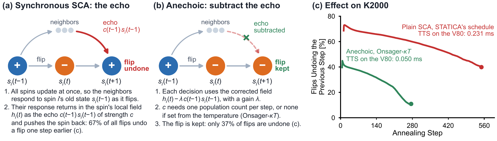
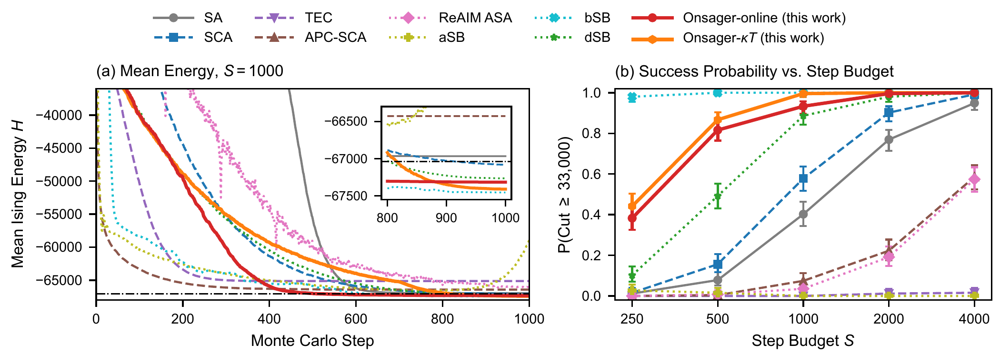
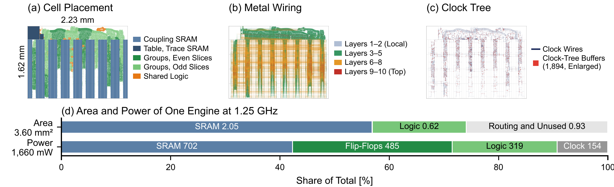
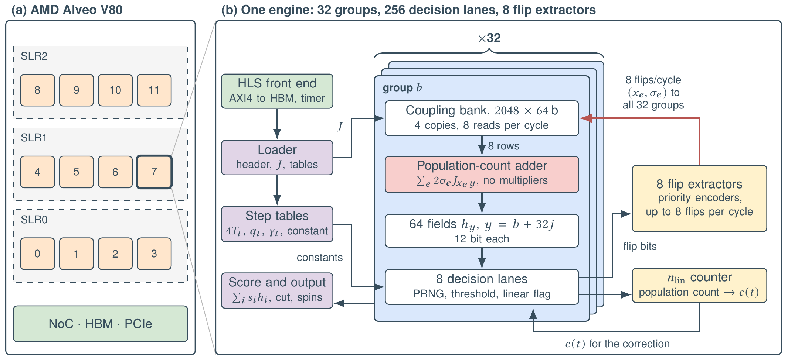

# Anechoic: Onsager-Corrected Parallel Annealing for Sub-0.1 ms Dense Max-Cut on an FPGA

Official implementation of **Anechoic**, with the RTL engine for the AMD Alveo V80, the bit-exact GPU kernel, the ASIC RTL, the golden models, the machine-checked proofs, and the summary data behind the paper.

By **Seungki Hong**, **Kyeongwon Jeong**, and **Taekwang Jang**<br>
ETH Zurich and Yonsei University

[](https://arxiv.org/abs/2610.13368)
[](https://github.com/skethz/Anechoic)
[](#results)

> **Abstract:** Ising machines solve combinatorial optimization problems by annealing a network of spins. On dense problems, where every spin couples to every other, the least expensive hardware step updates all spins at once: stochastic cellular automata (SCA) decide every spin in parallel and read couplings only for the spins that flip. Such synchronous updates, however, *create an echo: the previous state of each spin returns to it through its neighbors*. On K2000, the Max-Cut benchmark on a complete graph of 2,000 nodes, two-thirds of all flips undo a flip that the same spin made one step earlier. This paper presents *Anechoic*, an FPGA Ising machine that *subtracts this echo from every decision*. Dynamical mean-field theory identifies the echo as an Onsager reaction and gives the strength of its one-step part: *the number of spins whose flip probability lies strictly between 0 and 1, divided by twice the temperature*. The decision logic already flags these spins, so this Onsager correction costs one population count per step, and a temperature-scaled approximation needs no count. A hand-written RTL engine executes a dense 2,000-spin step in 18.1 cycles plus 0.14 cycles per flip, so every step and flip that the correction saves is saved time. In experiments, the counted and the temperature-scaled correction both find better K2000 cuts at every step budget than each of five published binary-spin algorithms run at its paper's settings. Twelve engines at 250 MHz on an AMD Alveo V80 reach a cut of at least 33,000 on K2000 with 99% probability in **0.05 ms, 5.2× faster than the fastest published hardware**, at 5.4 mJ per solution; with 2-bit couplings, the temperature-scaled form is also faster than uncorrected SCA on 48 of 51 sparse G-set graphs. On an NVIDIA GH200 GPU, the identical engine is 2.3× slower and needs 8.0× more energy per solution, though its 240 concurrent anneals give 2.3× higher throughput. As a GlobalFoundries 22 nm ASIC routed at 1.25 GHz (typical corner), twelve engines would reach the target in about **10 µs, 26× faster than the fastest published hardware**, with 0.20 mJ of engine energy per solution.

<p align="center">
  
</p>

*The echo and its removal. (a) In synchronous SCA, the echo of a spin's state before a flip pushes the spin back. (b) Anechoic subtracts the echo from every decision. (c) Share of flips that undo the previous step on K2000 (engine model, 1,024 runs per schedule), with TTS measured on the V80.*

## 📑 Contents

1. [Environment](#environment)
2. [Installation](#installation)
3. [Benchmark Data](#benchmark-data)
4. [Quick Start](#quick-start)
5. [FPGA](#fpga)
6. [GPU](#gpu)
7. [ASIC](#asic)
8. [Results](#results)
9. [Visual Results](#visual-results)
10. [Architecture Overview](#architecture-overview)
11. [Reproducibility](#reproducibility)
12. [Citation](#citation)

## <a name="environment"></a> 📢 Environment

- Python 3.12 and a C++17 compiler for the studies, golden models, and vector generators.
- AMD Vivado/Vitis 2025.1, the [AVED](https://github.com/Xilinx/AVED) shell, and an AMD Alveo V80 for the FPGA builds.
- CUDA 13.3 and an NVIDIA GH200 (sm_90) for the GPU kernels.
- A Verilog simulator (Siemens Questa or AMD Vivado xsim) for the RTL regressions.
- Lean 4 (v4.35.0-rc4) with Mathlib and the Rocq Prover 9.3 for the proofs.

## <a name="installation"></a> ⚙️ Installation

```bash
git clone https://github.com/skethz/Anechoic.git
cd Anechoic

python3 -m venv .venv
source .venv/bin/activate

pip install -r requirements.txt
pip install -r requirements-benchmarks.txt  # optional: DMFT solver and Neal reference
```

## <a name="benchmark-data"></a> 🧩 Benchmark Data

The benchmark instances are not redistributed. The script below downloads them from their original sources, checks every file against the SHA-256 recorded in the experiments, and places it where the scripts expect it.

```bash
python data/fetch_data.py                # everything
python data/fetch_data.py --only k2000   # or only k2000 | gset | tsplib
```

| Data | Contents | Source |
| --- | --- | --- |
| K2000 | Complete graph, 2,000 nodes, ±1 weights | [hariby/SA-complete-graph](https://github.com/hariby/SA-complete-graph) |
| G-set | 51 instances (G1–G47, G51–G54) | [Y. Ye, Stanford University](https://web.stanford.edu/~yyye/yyye/Gset/) |
| TSPLIB95 | gr17, gr21, gr24, fri26, bayg29, bays29, and optimal tours | [Heidelberg University](https://comopt.ifi.uni-heidelberg.de/software/TSPLIB95/) |

See the [data guide](data/README.md) for commits, conversions, and target directories.

## <a name="quick-start"></a> 🔧 Quick Start

These checks need only the Python packages, a C++ compiler, and K2000 (`python data/fetch_data.py --only k2000`).

```bash
mkdir -p outputs

# Golden model: the bias-capable reference equals the base model bit for bit.
c++ -O2 -std=c++17 -DSCA_LANES=256 fpga/v80_sca/src/test_ref_bias.cpp -o outputs/test_ref_bias
outputs/test_ref_bias data/k2000/K2000.bin   # 16 of 16 checks passed

# Baselines: self-test of the published-settings implementations.
python research/fairness_audit_20261008/k2000_pub/pub_methods.py   # pub_methods selftest OK

# Figure 1: regenerate the plot from the recorded echo statistics.
python research/headline_echo_20261009/plot_headline.py outputs/figure1.pdf
```

To check any table or figure, use the paper's name for it:

```bash
python reproduce.py --list
python reproduce.py table2 figure3
python reproduce.py all
```

Each line says whether the value was computed again, plotted from stored data or read from a stored measurement. See the [reproduction guide](docs/reproduction.md) for the details.

## <a name="fpga"></a> 🔩 FPGA

Twelve hand-written RTL engines run at 250 MHz on the AMD Alveo V80. One step takes 18.1 cycles plus 0.14 cycles per flip.

| Routed resources (v6) | Per engine | Total (12 + shell) |
| --- | ---: | ---: |
| LUT | 149,512 | 1,906,208 (74.0%) |
| Flip-flops | 131,555 | 1,767,564 (34.3%) |
| BRAM (36 Kb tiles) | 258 | 3,318 (88.7%) |
| URAM | 66 | 792 (41.1%) |
| DSP58 | 282 | 3,384 (31.2%) |
| Trials per second (O1, sustained) | 20,200 | 242,600 |

The RTL is in [`fpga/v80_sca/src/v6/`](fpga/v80_sca/src/v6/), the design in [`DESIGN.md`](fpga/v80_sca/DESIGN.md), and the measurements in [`RESULTS_HW.md`](fpga/v80_sca/RESULTS_HW.md) and [`RESULTS_MULTIBIT.md`](fpga/v80_sca/RESULTS_MULTIBIT.md). The builds also use the AVED shell and platform scripts that are not part of this repository; see the [FPGA notes](docs/reproduction.md#fpga-builds).

## <a name="gpu"></a> 🔨 GPU

The GH200 kernel reproduces the reference model, and therefore the V80, in 424 of 424 traced trials. Up to 240 chains run concurrently.

```bash
cd gpu/onsager_v2_20261007
bash src/build.sh   # on a GH200 host with CUDA 13.3
```

The kernel is [`src/sca_gpu.cu`](gpu/onsager_v2_20261007/src/sca_gpu.cu), and the measurements are in its [report](gpu/onsager_v2_20261007/REPORT.md). The kernel with multi-bit couplings and bias is in [`gpu/multibit_bias_20261008/`](gpu/multibit_bias_20261008/).

## <a name="asic"></a> 🧱 ASIC

One v6 engine is placed and routed in GlobalFoundries 22FDX. The variant is bit- and cycle-exact to the FPGA engine in RTL simulation on eight test sets. The values below are estimates from the routed layout, not silicon measurements.

| One engine, after routing (typical corner) | Value |
| --- | ---: |
| Clock (setup / hold slack) | 1.25 GHz (+7 / +191 ps) |
| Die area | 3.60 mm² (2.23 × 1.62 mm) |
| Cell area: SRAM / logic | 2.05 / 0.62 mm² |
| Cells / flip-flops (clock-gated) | 866 k / 162 k (29%) |
| Power (leakage) | 1,660 mW (6 mW) |
| Energy per trial (O1) | 16.4 µJ |
| SRAM energy per applied flip | 0.15 nJ |

Power comes from the toggle rates of one K2000 trial with schedule O1 in RTL simulation. The folders in [`asic/`](asic/) contain the RTL, its regression against the golden model, and the derived 12-engine totals. Synthesis and place-and-route scripts and reports are not included, because they depend on a foundry design kit under a non-disclosure agreement.

## <a name="results"></a> 📈 Results

### Time-to-solution on K2000

**TTS<sub>99</sub>** on the K2000 Max-Cut instance: a CPU baseline first, then hardware Ising machines in order of publication. Anechoic is in bold.

| Machine | Hardware | Target cut | t<sub>a</sub> (ms) | P<sub>a</sub> | TTS<sub>99</sub> (ms) |
| --- | --- | ---: | ---: | ---: | ---: |
| Neal | CPU | 33,000 | 4,610 / 5,646 | 0.38 / 0.77 | 44,413 / 17,693 |
| CIM | Optics | 33,000 | 5.0 | 0.02 | 1,139.74 |
| SB | FPGA | 33,000 | 0.5 | 0.04 | 56.41 |
| STATICA | CMOS | 33,000 | 0.13 / 0.48 | 0.07 / 0.77 | 8.23 / 1.50 |
| bSB | FPGA | 33,004 | — | — | 0.26 |
| ReAIM | ReRAM | 33,000 | 0.15 / 0.23 | 0.47 / 0.8 | 1.11 / 0.68 |
| GbSB | FPGA | 33,337 | 9.42 | 0.989 | 9.61 |
| DSSA | CMOS | not stated | 2.30 | 0.98 | 2.7 |
| **Anechoic** | **FPGA** | **33,000** | **0.05** | **1.00** | **0.05** |
| **Anechoic** | **GPU** | **33,000** | **0.11** | **1.00** | **0.11** |
| **Anechoic** | **CMOS** | **33,000** | **0.01** | **1.00** | **0.01** |

Values of other machines are quoted from the cited publications, with their targets and conditions in Table 4 of the paper. All CMOS and ReRAM results are simulations. Anechoic uses Onsager-κT and the primary estimator: FPGA is an AMD Alveo V80 with 12 engines at 250 MHz, GPU is an NVIDIA GH200 with 120 chains, and CMOS is a simulation of 12 GlobalFoundries 22FDX engines routed at 1.25 GHz.

### One engine on three platforms

The same bit-exact engine on K2000, cut ≥ 33,000. The V80 and GH200 are measured; the ASIC is estimated.

| | V80 | GH200 | ASIC |
| --- | ---: | ---: | ---: |
| Engines or concurrent chains | 12 | 120–240 | 12 |
| Step latency, one chain (µs) | 0.15–0.18 | 0.63–0.72 | 0.031–0.035 |
| Primary TTS<sub>99</sub> (ms) | 0.050 | 0.114 | 0.010 |
| Secondary TTS<sub>99</sub> (ms) | 0.018 | 0.0078 | 0.0036 |
| Power (W) | 108<sup>a</sup> | 382 | 19.9<sup>b</sup> |
| Energy per solution (mJ) | 5.4<sup>a</sup> | 43 | 0.20<sup>b</sup> |
| Area (mm²) | — | — | 43<sup>b</sup> |

<sup>a</sup>Board; engines: 39 W, 2.0 mJ per solution. <sup>b</sup>Engines only. The GPU uses 120 chains for the primary and 240 for the secondary TTS<sub>99</sub>.

### G-set

Measured speedup on 51 G-set Max-Cut instances: how many times sooner the corrected rule reaches a cut within 1% of the best known, from the twelve-engine TTS<sub>99</sub> on the V80 (geometric mean; in parentheses: instances on which it is faster).

| Graphs (instances) | Onsager-κT vs plain SCA | Onsager-κT vs TEC-style | Onsager-online vs plain SCA | Onsager-online vs TEC-style |
| --- | ---: | ---: | ---: | ---: |
| Random, +1 (15) | 1.68 (14) | 0.96 (6) | 1.32 (10) | 0.75 (8) |
| Random, ±1 (10) | 2.21 (10) | 1.91 (10) | 1.64 (9) | 1.42 (7) |
| Toroidal, ±1 (6) | 4.56 (6) | 3.83 (6) | 1.45 (6) | 1.22 (4) |
| Planar-like, +1 (12) | 2.71 (12) | 2.15 (12) | 0.82 (2) | 0.65 (1) |
| Planar-like, ±1 (8) | 1.39 (7) | 1.52 (8) | 1.45 (8) | 1.59 (8) |
| **All 51** | **2.17 (49)** | **1.68 (42)** | 1.26 (35) | 0.98 (28) |

These use the extended grids of a pre-registered amendment. With the pre-registered grids, Onsager-κT is faster than plain SCA on 48 of 51 instances (1.99×) and than TEC-style on 41 (1.55×).

## <a name="visual-results"></a> 🔎 Visual Results

### Algorithm-level comparison on K2000



(a) Mean Ising energy versus Monte Carlo step at S = 1000. (b) Fraction of 256 held-out runs that reach the 33,000-cut target versus the step budget, with 95% Wilson intervals. The baselines use their papers' settings, and only the two corrected forms are tuned per budget.

### ASIC layout of one engine



(a) SRAM macros and standard cells by design hierarchy. (b) Signal and clock wiring by metal layer. (c) Clock tree. (d) Area and power at the typical corner (0.80 V, 25 °C).

## <a name="architecture-overview"></a> 📐 Architecture Overview

Each step costs only what the algorithm needs: N decisions, plus one coupling row for each spin that flips. Twelve engines, four per SLR, share the NoC and HBM of the AVED shell. In each engine, 32 groups own their coupling bank, 64 fields, and 8 decision lanes, so coupling reads and field updates stay in the group.



Eight extractors drain the flip bits while later rounds are still deciding, and broadcast up to eight flipped spins per cycle to all groups, which update their fields by population counts. The count n<sub>lin</sub> of linear decisions gives the coefficient c(t) of the correction.

## <a name="reproducibility"></a> ✅ Reproducibility

The [reproduction guide](docs/reproduction.md) maps every paper figure and table to its code and data, and describes the repository structure, FPGA and GPU builds, RTL regressions, and release notes such as placeholders and hash records. The Rocq proofs can be re-checked with:

```bash
cd research/formal_verification_20261007/coq
coqc Anechoic.v && coqchk -silent -o -R . "" Anechoic
```

Per-trial records, spin states, and traces are not included because of their size. The summaries, and the scripts that produced them, are included.

## <a name="citation"></a> 📚 Citation

```bibtex
@misc{hong2026anechoic,
      title={{Anechoic: Onsager-Corrected Parallel Annealing for Sub-0.1 ms Dense Max-Cut on an FPGA}},
      author={Seungki Hong and Kyeongwon Jeong and Taekwang Jang},
      year={2026},
      eprint={2610.13368},
      archivePrefix={arXiv},
      primaryClass={cs.AR},
      url={https://arxiv.org/abs/2610.13368},
}
```
